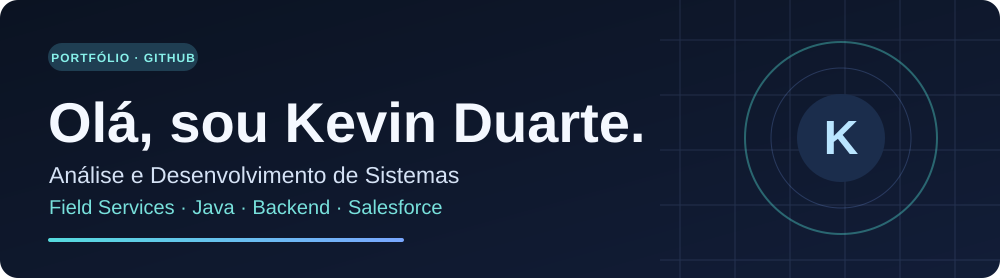

<!--
Perfil profissional — Kevin Duarte
Versão inicial: foco na apresentação pessoal. Projetos serão revisados em uma etapa futura.
Os dados profissionais foram adaptados do currículo fornecido pelo titular.
-->

  

  <strong>Java & Backend em desenvolvimento • Formado em ADS • Analista de Field Services</strong>

  
  
  
  

---

### 👨‍💻 Sobre mim

Sou formado em **Análise e Desenvolvimento de Sistemas pelo Centro Universitário SENAC** e atuo com tecnologia, suporte corporativo, infraestrutura e resolução de problemas.

Atualmente, trabalho como **Analista de Field Services N1 na NAVA | Tech for Business, alocado na Brasilprev**. Atendo incidentes e requisições de colaboradores, presencialmente e de forma remota, apoiando o funcionamento de sistemas, equipamentos e ferramentas corporativas.

Estou direcionando minha carreira para o **desenvolvimento de software, com foco em Java e backend**. Tenho conhecimentos em programação orientada a objetos, Spring Boot e bancos de dados, construídos durante a graduação e em projetos de estudo.

### 🧰 Linguagens e tecnologias

  

- **Desenvolvimento:** Java, JavaScript, HTML, CSS, Spring Boot, SQL/MySQL e H2 (acadêmico).
- **Experiência em projetos acadêmicos:** Java orientado a objetos e React Native.
- **Ferramentas e suporte corporativo:** Git/GitHub, ServiceNow, Active Directory, Microsoft 365, Intune, SCCM e atendimento de suporte relacionado ao Salesforce.
- **Em aprofundamento:** desenvolvimento Java backend, fundamentos de AWS e desenvolvimento na plataforma Salesforce.

### 💼 Experiência profissional

**NAVA | Tech for Business — Analista de Field Services N1**  
*Fev/2026 – atualmente • Atuação na Brasilprev*

Suporte técnico presencial e remoto, troubleshooting, registro e acompanhamento de chamados, gestão de acessos e preparação de equipamentos corporativos.

**S8ITech — Estagiário / Analista de Suporte em TI**  
*Mai/2025 – Set/2025*

Experiência com infraestrutura, hospedagem de sites e domínios, suporte a sistemas, atividades relacionadas a e-commerce e apoio pontual em JavaScript.

### 🎓 Formação e aprendizado

**Tecnólogo em Análise e Desenvolvimento de Sistemas**  
Centro Universitário SENAC • Conclusão em dezembro de 2025.

- [**AWS Academy Cloud Foundations** — 40h](https://www.credly.com/go/QGCaFLzx) • Fundamentos de computação em nuvem.
- **Oracle Academy — Database Foundations** — 40h • Fundamentos de bancos de dados.

### 🚧 Projetos em evolução

Estou revisitando meus projetos acadêmicos, incluindo **um RPG em Java** e **um aplicativo de aluguel de carros em React Native**. Pretendo destacar os repositórios após atualizar o código e a documentação.

  
📊 Ver estatísticas do GitHub

  

    
    
  

  
<em>Esses gráficos são gerados por um serviço externo. A proporção de linguagens nos repositórios não representa o nível de domínio profissional.</em>

---

  <strong>Vamos conversar?</strong> 
  <a href="https://www.linkedin.com/in/kevin-duarte-79b651293/">LinkedIn</a> •
  <a href="mailto:kevin1157.kd@gmail.com">E-mail</a> •
  <a href="https://kevin1157duarte.github.io/Portfolio/">Portfólio</a> •
  <a href="https://github.com/kevin1157duarte">GitHub</a>

